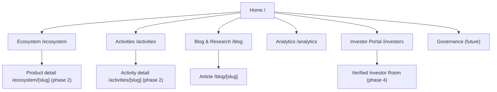
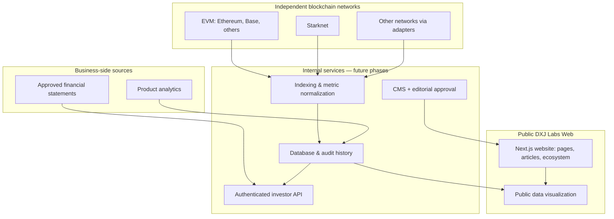

# DXJ Labs — Sitemap & System Architecture V1

## Sitemap

**Navigation:** Home / Ecosystem / Activities / Blog / Analytics / Investors / GitHub.

## System boundaries

**Important:** This diagram represents a **target architecture**, not a statement that indexers, a CMS, investor API, or token infrastructure are running.

## Data contracts

- `ChainReference`: CAIP-2 ID; display name; namespace; environment; explorer URL; support stage.
- `Product`: ID, slug, development stage, categories, chain affiliations, source repositories, proof links, token lifecycle.
- `Activity`: date, organizer, type, current state, evidence URL and summary.
- `Article`: slug, category, publication date, author, body, editorial status.
- `Metric`: nullable value, provenance, update time, aggregation rule, verification status.
- `InvestorDocument` (later): owner, access policy, confidentiality level, timestamp, audit trail.

## Safety boundaries
- Public pages are public by intent. Do not embed investor secrets into HTML, JSON, static output or CDN assets.
- Real token contract entries require chain ID, address, deployment evidence, admin controls, and legal signoff before the UI changes from "planned".
- Cross-chain aggregates must not double count bridging or repeated wallets.
- Activity claims should link to first-party records, event pages, or project commits.

## Initial implementation
Content-first static routes with typed data objects; no fake APIs or simulated login. Subsequent CMS/indexers replace the data source behind the same UI contracts.

**References:** Chain-agnostic naming: https://standards.chainagnostic.org/CAIPs/caip-2 ; Next.js App Router: https://nextjs.org/docs/app/getting-started/layouts-and-pages .
